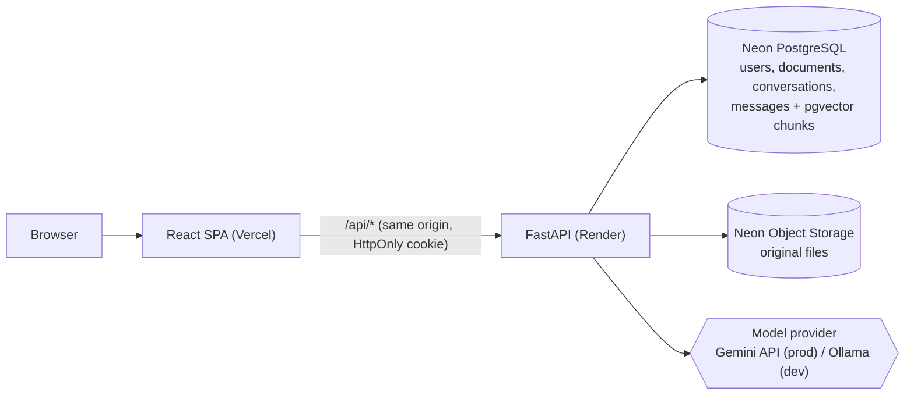

# AI Knowledge Base Assistant

Upload PDF and TXT documents, then ask questions about them. Answers are generated only from the
retrieved passages of **your own** documents, and every answer shows its sources: file name, page
and the exact excerpt. When the documents don't contain the answer, the assistant says so instead
of guessing.

Full-stack RAG (retrieval-augmented generation) application: React + FastAPI + PostgreSQL/pgvector
+ LangChain, with a local model (Ollama) for development and a hosted model (Gemini) in production.

## Architecture



**Question flow:** authenticate → embed the question → vector search limited to the user's own
documents whose status is `ready` (one SQL query) → relevance threshold → if no evidence, answer
"not enough information" without calling the model → otherwise prompt the model with the evidence
→ validate the answer and build citations from the retrieved chunks → store both messages.

**Upload flow:** validate type, size and content → SHA-256 duplicate check per user → store the file
→ background task: extract text per page → normalize → chunk → embed → store vectors → `ready` / `failed`.

## Features

- Registration and login with Argon2 password hashing, JWT in an HttpOnly cookie and CSRF protection
- Strict per-user isolation of documents, vectors, citations and conversations (other users' data returns 404)
- PDF and TXT upload with progress, validation (type, size, empty, scanned or damaged PDFs) and duplicate detection
- Page-aware chunking; citations with file, page and excerpt that link to the original PDF page
- "Insufficient evidence" answers for questions the documents don't cover
- Conversation history with a bounded context window; history is never treated as evidence
- Safe Markdown rendering of model output (no raw HTML)
- Pluggable providers: Ollama or any OpenAI-compatible API (chat and embeddings), Chroma or pgvector, local disk or S3
- Rate limiting, structured JSON logs with secret redaction, consistent JSON errors, health and readiness endpoints

## Tech stack

| Layer | Technology |
|---|---|
| Frontend | React 19, Vite 8, TypeScript (strict), Tailwind CSS 4, React Router, react-markdown |
| Backend | Python 3.12, FastAPI, Pydantic 2, SQLAlchemy 2.1, Alembic, structlog |
| RAG | LangChain (text splitting, embeddings, chat models), pypdf |
| Data | Neon PostgreSQL + pgvector, Neon Object Storage (S3 API) |
| Models | Gemini `gemini-3.5-flash-lite` + `gemini-embedding-2` (768-dim); Ollama `qwen2.5:1.5b` + `nomic-embed-text` locally |
| Hosting | Vercel (frontend), Render (backend) |

## Run locally (Windows PowerShell)

Requirements: Python 3.12, Node.js 22, a Neon project, and either a Gemini API key or Ollama.

```powershell
# Backend
cd backend
py -3.12 -m venv .venv
.\.venv\Scripts\Activate.ps1
pip install -r requirements-dev.txt
Copy-Item .env.example .env          # then fill in JWT_SECRET and the model settings
neon checkout dev                    # writes DATABASE_URL and storage credentials to ..\.env.local
alembic upgrade head
uvicorn app.main:app --port 8001     # API docs: http://127.0.0.1:8001/api/docs

# Frontend (second terminal)
cd frontend
npm install
npm run dev                          # http://localhost:5173 (proxies /api to port 8001)
```

Every setting is documented in [backend/.env.example](backend/.env.example). Useful scripts:

| Command (from `backend/`) | Purpose |
|---|---|
| `python -m scripts.check_env` | Checks configuration, models, vector store and database |
| `python -m scripts.smoke_test [url]` | End-to-end test against a running API (two users, upload, ask, isolation, cleanup) |
| `python -m scripts.reindex_documents` | Rebuilds all vectors after changing the embedding model |
| `python -m scripts.rag_cli ask "..."` | Try the RAG pipeline from the command line |
| `python -m scripts.evaluate [--judge]` | Retrieval and answer-quality evaluation (see [Evaluation](#evaluation)) |

## Try it in two minutes

1. Register an account (the app opens on the Documents page).
2. Upload the PDFs from [samples/](samples/), for example `northwind_security_policy.pdf`, and wait until it shows **Ready**.
3. Open **Chat** and ask *"What should I do if my laptop is stolen?"*. The answer cites the policy's page 2; click the source to see the excerpt or open the PDF at that page.
4. Ask *"What is the capital of France?"*. The assistant replies that your documents don't contain the answer.
5. Register a second account in a private window: it sees none of the first account's documents or conversations.

## API

All endpoints are under `/api`. Requests that change data need the `X-CSRF-Token` header (the
token is returned by register, login and `/auth/me`). Errors always have the shape
`{"error": {"code": "...", "message": "...", "details": ...}}`. Interactive documentation is
served at `/api/docs` outside production.

| Method | Path | Auth | Purpose |
|---|---|---|---|
| GET | `/health` | - | Liveness check (no dependencies) |
| GET | `/health/ready` | - | Database connectivity and migration version |
| POST | `/auth/register` | - | Create an account and start a session (201) |
| POST | `/auth/login` | - | Start a session |
| POST | `/auth/logout` | - | Clear the session cookies (204) |
| GET | `/auth/me` | session | Current user and CSRF token |
| POST | `/documents` | session + CSRF | Upload a PDF/TXT (multipart, 202; indexing continues in the background) |
| GET | `/documents` | session | List your documents with status |
| GET | `/documents/{id}` | session | One document (404 if it is not yours) |
| GET | `/documents/{id}/file` | session | The original file, shown inline |
| POST | `/documents/{id}/retry` | session + CSRF | Re-process a failed document (202) |
| DELETE | `/documents/{id}` | session + CSRF | Delete the document, its vectors and file (204) |
| POST | `/conversations` | session + CSRF | Start a conversation (201) |
| GET | `/conversations` | session | List your conversations |
| GET | `/conversations/{id}` | session | A conversation with its messages and stored citations |
| DELETE | `/conversations/{id}` | session + CSRF | Delete a conversation (204) |
| POST | `/conversations/{id}/messages` | session + CSRF | Ask a question; returns both messages, citations and `sufficient_evidence` |

Common status codes: 401 not logged in or session expired, 403 missing CSRF token, 404 not found
or not yours, 409 duplicate upload or email, 413 file too large, 415 unsupported file type,
422 invalid input or unreadable document, 429 rate limited, 503/504 model, storage or index unavailable.

## Tests

```powershell
cd backend
python -m pytest -q                                          # unit + API tests, offline (fake models, SQLite, local Chroma)
$env:RUN_INTEGRATION="1"; python -m pytest -q tests/integration   # against the Neon dev branch
```

The tests cover authentication (cookies, expired and forged tokens, CSRF, rate limits), user
isolation, invalid uploads, duplicate detection, document deletion and vector cleanup, retrieval,
insufficient-evidence answers, provider timeouts, rate-limit and failure handling, and pgvector
behaviour (owner and status filtering, cascade delete, atomic re-indexing).

## Evaluation

`python -m scripts.evaluate --judge` scores the pipeline on a labelled dataset of 50 questions
([backend/evaluation/dataset.json](backend/evaluation/dataset.json)) about the five fictional
sample documents: 40 answerable (each with its source file, page, supporting passage and key facts)
and 10 unanswerable. The sample documents overlap on purpose (two different "P1" response times,
leave in two documents, laptops in two documents). Metrics are computed in plain Python
([backend/evaluation/metrics.py](backend/evaluation/metrics.py)).

Latest run ([full report](backend/evaluation/REPORT.md)): Gemini `gemini-3.5-flash-lite` with
`gemini-embedding-2` (768 dimensions), 14 chunks.

| Retrieval (40 questions) | Result |
|---|---|
| Recall@5 / Recall@3 | 100% / 100% |
| Recall@1 | 97.5% (one question ranked its passage 2nd, behind an overlapping travel-allowance page) |
| MRR | 0.988 |

| Answers | Result |
|---|---|
| Answerable: answered, with all key facts and a correct citation | 40 / 40 |
| Numbers in answers found in the retrieved passages | 40 / 40 |
| Judged supported by the passages (LLM judge) | 40 / 40 |
| Unanswerable: correctly refused | 10 / 10 (3 by the relevance threshold before any model call, 7 by the model) |
| Answer latency p50 / p95 (from a laptop, excluding rate-limit waits) | 1.46 s / 3.44 s |

These scores are at the ceiling, which mainly shows that this small, self-written dataset is too easy
to separate a good system from a better one. The corpus is tiny (14 chunks), the key-fact and number
checks are string matches, and the judge is the same model that wrote the answers. Treat the numbers
as a regression baseline, not as evidence of how the system performs on large real-world documents.

## Deployment

- **Backend → Render** using [render.yaml](render.yaml). Secrets (database URLs, storage credentials,
  API key, JWT secret) are set in the Render dashboard. Migrations run on start.
- **Frontend → Vercel** with the project root set to `frontend/`. [frontend/vercel.json](frontend/vercel.json)
  forwards `/api/*` to Render, so the browser talks to a single origin and the session cookie stays first-party.
  Response caching for `/api/*` is disabled there and by a `Cache-Control: private, no-store` header from the API.
- **Database and files → Neon** (`neon.ts` declares the `documents` bucket; `neon deploy --branch production`).

## Security notes

- Passwords hashed with Argon2id; login gives the same answer for unknown emails and wrong passwords.
- The session JWT is in an HttpOnly, SameSite=Lax (Secure in production) cookie; state-changing
  requests also need the CSRF token from the token's claims.
- The user identity comes only from the signed token. Every query filters by owner; vector search
  joins to the documents table and only uses the owner's `ready` documents.
- Retrieved text is treated as untrusted: the system prompt tells the model to ignore instructions
  inside documents, and document text cannot close the evidence block. This reduces, but does not
  eliminate, prompt-injection risk.
- Citations come from retrieved chunks, never from model output; unknown citation labels are removed.

## Known limitations

- Documents are processed in a background task inside the web process; a restart interrupts
  processing (such documents are marked failed and can be retried).
- Rate limits are kept in memory per process.
- Logout clears the cookies, but a token stays valid until it expires (default 60 minutes).
- Scanned PDFs (images without a text layer) are not supported (no OCR).
- On the Gemini free tier, Google may use submitted content to improve its products; don't upload
  sensitive documents to a deployment that uses it.
- On Render's free plan the backend sleeps after 15 minutes without traffic; the first request
  afterwards takes about a minute.

## Project structure

```
backend/
  app/          FastAPI app: api, core, db, models, repositories, services, rag
  alembic/      Database migrations
  evaluation/   Labelled dataset, metrics, latest report and results
  scripts/      Environment check, smoke test, evaluation, re-indexing, CLI
  tests/        Unit and API tests (offline) and integration tests (Neon)
frontend/       React app: components, pages, hooks, services, types
samples/        Fictional sample documents used in tests, evaluation and demos
docs/           Architecture notes
render.yaml     Backend deployment (Render)
neon.ts         Neon configuration (object storage bucket)
```
