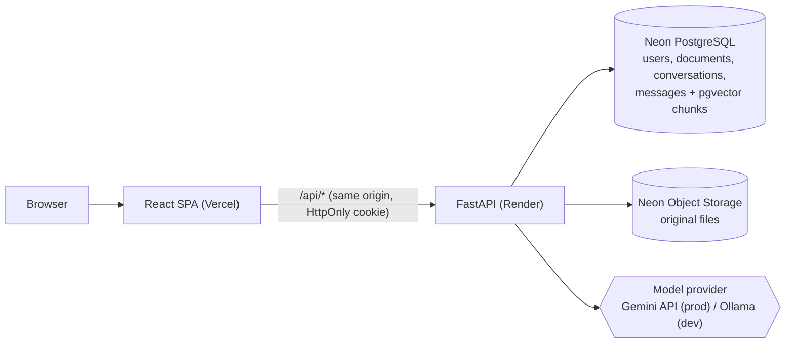

# AI Knowledge Base Assistant

Upload PDF and TXT documents, then ask questions about them. Answers are generated only from the
retrieved passages of **your own** documents, and every answer shows its sources: file name, page
and the exact excerpt. When the documents don't contain the answer, the assistant says so instead
of guessing.

Full-stack RAG (retrieval-augmented generation) application: React + FastAPI + PostgreSQL/pgvector
+ LangChain, with a local model (Ollama) for development and a hosted model (Gemini) in production.

## Architecture



**Question flow:** authenticate → embed the question → vector search limited to the user's own
documents whose status is `ready` (one SQL query) → relevance threshold → if no evidence, answer
"not enough information" without calling the model → otherwise prompt the model with the evidence
→ validate the answer and build citations from the retrieved chunks → store both messages.

**Upload flow:** validate type, size and content → SHA-256 duplicate check per user → store the file
→ background task: extract text per page → normalize → chunk → embed → store vectors → `ready` / `failed`.

## Features

- Registration and login with Argon2 password hashing, JWT in an HttpOnly cookie and CSRF protection
- Strict per-user isolation of documents, vectors, citations and conversations (other users' data returns 404)
- PDF and TXT upload with progress, validation (type, size, empty, scanned or damaged PDFs) and duplicate detection
- Page-aware chunking; citations with file, page and excerpt that link to the original PDF page
- "Insufficient evidence" answers for questions the documents don't cover
- Conversation history with a bounded context window; history is never treated as evidence
- Safe Markdown rendering of model output (no raw HTML)
- Pluggable providers: Ollama or any OpenAI-compatible API (chat and embeddings), Chroma or pgvector, local disk or S3
- Rate limiting, structured JSON logs with secret redaction, consistent JSON errors, health and readiness endpoints

## Tech stack

| Layer | Technology |
|---|---|
| Frontend | React 19, Vite 8, TypeScript (strict), Tailwind CSS 4, React Router, react-markdown |
| Backend | Python 3.12, FastAPI, Pydantic 2, SQLAlchemy 2.1, Alembic, structlog |
| RAG | LangChain (text splitting, embeddings, chat models), pypdf |
| Data | Neon PostgreSQL + pgvector, Neon Object Storage (S3 API) |
| Models | Gemini `gemini-3.5-flash-lite` + `gemini-embedding-2` (768-dim); Ollama `qwen2.5:1.5b` + `nomic-embed-text` locally |
| Hosting | Vercel (frontend), Render (backend) |

## Run locally (Windows PowerShell)

Requirements: Python 3.12, Node.js 22, a Neon project, and either a Gemini API key or Ollama.

```powershell
# Backend
cd backend
py -3.12 -m venv .venv
.\.venv\Scripts\Activate.ps1
pip install -r requirements-dev.txt
Copy-Item .env.example .env          # then fill in JWT_SECRET and the model settings
neon checkout dev                    # writes DATABASE_URL and storage credentials to ..\.env.local
alembic upgrade head
uvicorn app.main:app --port 8001     # API docs: http://127.0.0.1:8001/api/docs

# Frontend (second terminal)
cd frontend
npm install
npm run dev                          # http://localhost:5173 (proxies /api to port 8001)
```

Every setting is documented in [backend/.env.example](backend/.env.example). Useful scripts:

| Command (from `backend/`) | Purpose |
|---|---|
| `python -m scripts.check_env` | Checks configuration, models, vector store and database |
| `python -m scripts.smoke_test [url]` | End-to-end test against a running API (two users, upload, ask, isolation, cleanup) |
| `python -m scripts.reindex_documents` | Rebuilds all vectors after changing the embedding model |
| `python -m scripts.rag_cli ask "..."` | Try the RAG pipeline from the command line |

## Tests

```powershell
cd backend
python -m pytest -q                                          # unit + API tests, offline (fake models, SQLite, local Chroma)
$env:RUN_INTEGRATION="1"; python -m pytest -q tests/integration   # against the Neon dev branch
```

The tests cover authentication (cookies, expired and forged tokens, CSRF, rate limits), user
isolation, invalid uploads, duplicate detection, document deletion and vector cleanup, retrieval,
insufficient-evidence answers, provider timeouts, rate-limit and failure handling, and pgvector
behaviour (owner and status filtering, cascade delete, atomic re-indexing).

## Deployment

- **Backend → Render** using [render.yaml](render.yaml). Secrets (database URLs, storage credentials,
  API key, JWT secret) are set in the Render dashboard. Migrations run on start.
- **Frontend → Vercel** with the project root set to `frontend/`. [frontend/vercel.json](frontend/vercel.json)
  forwards `/api/*` to Render, so the browser talks to a single origin and the session cookie stays first-party.
  Response caching for `/api/*` is disabled there and by a `Cache-Control: private, no-store` header from the API.
- **Database and files → Neon** (`neon.ts` declares the `documents` bucket; `neon deploy --branch production`).

## Security notes

- Passwords hashed with Argon2id; login gives the same answer for unknown emails and wrong passwords.
- The session JWT is in an HttpOnly, SameSite=Lax (Secure in production) cookie; state-changing
  requests also need the CSRF token from the token's claims.
- The user identity comes only from the signed token. Every query filters by owner; vector search
  joins to the documents table and only uses the owner's `ready` documents.
- Retrieved text is treated as untrusted: the system prompt tells the model to ignore instructions
  inside documents, and document text cannot close the evidence block. This reduces, but does not
  eliminate, prompt-injection risk.
- Citations come from retrieved chunks, never from model output; unknown citation labels are removed.

## Known limitations

- Documents are processed in a background task inside the web process; a restart interrupts
  processing (such documents are marked failed and can be retried).
- Rate limits are kept in memory per process.
- Logout clears the cookies, but a token stays valid until it expires (default 60 minutes).
- Scanned PDFs (images without a text layer) are not supported (no OCR).
- On the Gemini free tier, Google may use submitted content to improve its products; don't upload
  sensitive documents to a deployment that uses it.
- On Render's free plan the backend sleeps after 15 minutes without traffic; the first request
  afterwards takes about a minute.

## Project structure

```
backend/   FastAPI app (api, core, db, models, repositories, services, rag), Alembic, tests, scripts
frontend/  React app (components, pages, hooks, services, types)
samples/   Fictional sample documents used in tests and demos
docs/      Architecture notes
```
