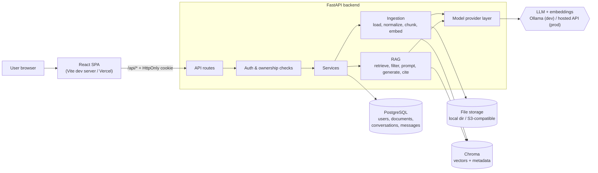

# Architecture

## Overview

A user signs in, uploads PDF or TXT files, and asks questions. The backend answers only from
the user's own documents and returns citations built from the chunks it actually retrieved.

- **Frontend (React + Vite)**: UI only. Holds no secrets and never talks to the database, the
  vector store or the LLM directly.
- **Backend (FastAPI)**: the single trusted component. It authenticates every request, enforces
  ownership, runs ingestion and the RAG pipeline, and calls the model provider.
- **PostgreSQL**: the source of truth for users, documents (metadata + status), conversations,
  messages and stored citations.
- **Object storage**: the original uploaded files (a local folder in development, S3-compatible
  storage in production).
- **Chroma**: chunk embeddings plus metadata (`owner_id`, `document_id`, `filename`, `page`, `chunk_id`).
- **Model provider**: Ollama locally; a hosted OpenAI-compatible API in production, selected by
  environment variables behind one provider module.

## Diagram

## Request flows

**Upload**: authenticate → validate type/size/content → hash the bytes (duplicate check per owner)
→ save the file → insert a `documents` row with `status=processing` → background task: extract
text per page → chunk → embed → write to Chroma with metadata → set `status=ready` (or `failed`
with a safe error message).

**Question**: authenticate → load the conversation (owner-checked) → embed the question → query
Chroma filtered by `owner_id` → drop any hit whose document is not `ready` and owned by the user
in PostgreSQL → apply the relevance threshold → if there is no usable evidence, return an
insufficient-evidence answer without calling the LLM → otherwise build the prompt (system rules +
recent history + evidence) → generate → attach citations built from the retrieved chunks → save
both messages.

## Local vs production

| Component      | Local development                      | Production                                         |
|----------------|----------------------------------------|----------------------------------------------------|
| Frontend       | `npm run dev` (Vite)                   | Vercel static build, `/api/*` rewritten to backend |
| Backend        | `uvicorn` on your laptop               | Python web host (e.g. Render, Railway)             |
| PostgreSQL     | Neon `dev` branch                      | Neon `production` branch                           |
| Uploaded files | `backend/data/uploads` or the `dev` bucket | Neon Object Storage bucket `documents` (S3 API) |
| Vectors        | Chroma folder or pgvector on `dev`     | pgvector table `document_chunks` in Neon           |
| Chat model     | Ollama `qwen2.5:1.5b` or Gemini        | Gemini `gemini-3.5-flash-lite` (OpenAI-compatible API) |
| Embeddings     | Ollama `nomic-embed-text` (768-dim) or Gemini | Gemini `gemini-embedding-2` at 768 dimensions |

The local Chroma directory and upload folder exist only on the machine they were written on.
They are never "deployed" with the code, and a server's ephemeral disk is wiped on redeploy.
